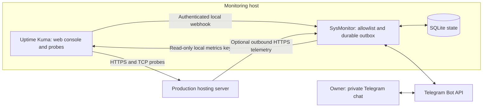

# SysMonitor

**A private server operations companion for Uptime Kuma, built for a production hosting server monitored from another country.**

SysMonitor combines an existing uptime engine and web console with a small, read-only Persian Telegram bot. It does not give a messaging account a root shell, restart services, or replace a monitoring engine with a custom ping loop.

> **Release status:** 0.1.0, initial implementation. Passing local tests is not evidence of a completed production deployment. See [verification](docs/VERIFICATION.md) for the exact boundary.

## What you get

| Surface | Purpose |
| --- | --- |
| Uptime Kuma web console | HTTP/TCP checks, latency, uptime history, TLS expiry, maintenance windows |
| Private Telegram bot | `/status`, `/resources`, `/uptime`, `/incidents`, `/test`, inline buttons |
| Durable alert queue | Alert persistence across bridge restarts and retry on Telegram delivery errors |
| Optional Linux collector | Small CPU/RAM/root-disk/swap/uptime/service-state sample, once per minute |
| Operations documentation | Research, architecture, installation, security, backup, rollback and acceptance tests |

The bridge has **zero third-party Python runtime dependencies**. Kuma remains upstream software, with its identity and MIT license preserved.

## Design



The telemetry arrow requires a separately configured TLS proxy. Both Kuma and the bridge bind to loopback by default. **No new inbound port is required on the production server.**

## Start here

1. Read the [research and decision](docs/RESEARCH.md).
2. Follow [deployment](docs/DEPLOYMENT.md), starting with uptime-only monitoring.
3. Use the [Persian operator guide](docs/OPERATIONS.fa.md).
4. Complete the [acceptance checklist](docs/VERIFICATION.md) before relying on alerts.

```bash
# Local verification; does not contact your production servers or Telegram.
python3 -m unittest discover -s tests -v
```

Python 3.9+ is required. The collector runs on Linux. The fresh-install Kuma script targets x86_64 Linux with systemd, existing curl/git/tar/xz, and no existing installation on its chosen paths. It pins Kuma 2.5.6 and uses a separate Node 22.23.3 runtime, leaving the system Node installation in place.

## Important limits

- A failure from the monitoring location proves loss of reachability from that location; it does not establish the root cause or the experience of every user.
- A monitor cannot notify while its own host, power or outbound network is unavailable. An independent dead-man monitor is needed for this failure mode.
- Telegram delivery can be delayed or unavailable. The queue retries, but cannot guarantee delivery or a response deadline.
- Delivery is **at least once**: if Telegram accepts a message and the process crashes before recording success, a duplicate can appear.
- Telemetry is optional. CPU/RAM information is never inferred from HTTP uptime, and stale measurements are labeled.
- SysMonitor keeps a current resource sample, not a resource time-series database. For rich historical resource graphs, add a reviewed Beszel deployment later.
- The collector reports service state in `/resources`; it does not currently generate separate service-state alerts. HTTP/TCP availability alerts remain Kuma's job.

## Project files

```text
sysmonitor/           bridge, persistence, formatting, Linux collector
tests/               authorization, retry, persistence, telemetry and HTTP integration tests
deploy/              systemd services, collector timer, fresh native Kuma installer
examples/            placeholder environment files only
docs/                research, deployment, operations and verification
```

## Attribution and license

SysMonitor: MIT, copyright Amir Hossein Khateri. [Uptime Kuma](https://github.com/louislam/uptime-kuma) and [SysReport](https://github.com/amirkhateri/sysreport) are separate projects. No upstream product is relabeled as SysMonitor. See [LICENSE](LICENSE), [SECURITY.md](SECURITY.md), [CONTRIBUTING.md](CONTRIBUTING.md) and [CHANGELOG.md](CHANGELOG.md).


### Resource policy and daily reports (0.2)

Disk alerts escalate at 80/90/95%; CPU and RAM require five elapsed minutes at 90% or above, with stale-gap resets and recovery hysteresis. Fixed process-group summaries help identify the largest observed consumers without customer paths or process arguments. Core service failures have their own sustained-state alerts.

Daily reports default to 23:00 Asia/Tehran. The owner can use `/daily on`, `/daily off` and `/daily time 23:30`; disabling reports never mutes alerts. See the [Persian operations guide](docs/OPERATIONS.fa.md) for measurement limits and controls.

The collector requires the operating system curl executable. The Python package has no third-party Python runtime dependencies. Network transport is fixed to verified HTTPS over HTTP/1.1; bearer credentials are passed to curl on stdin.
